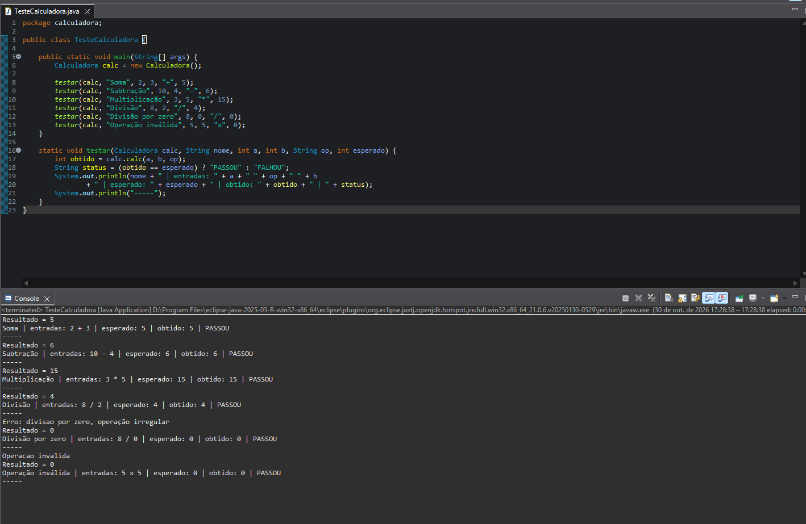
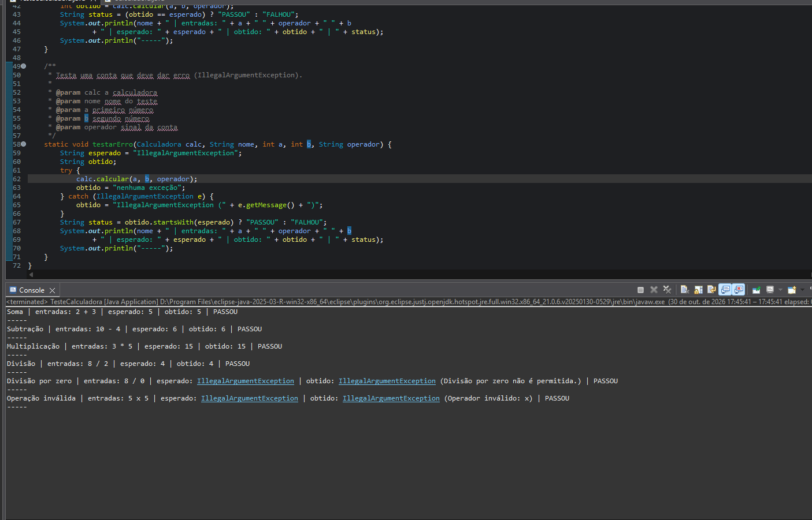
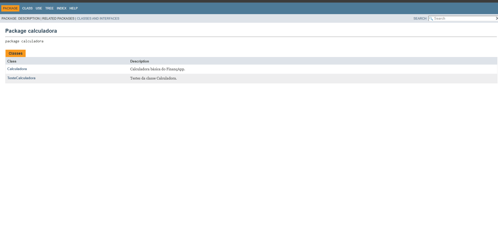
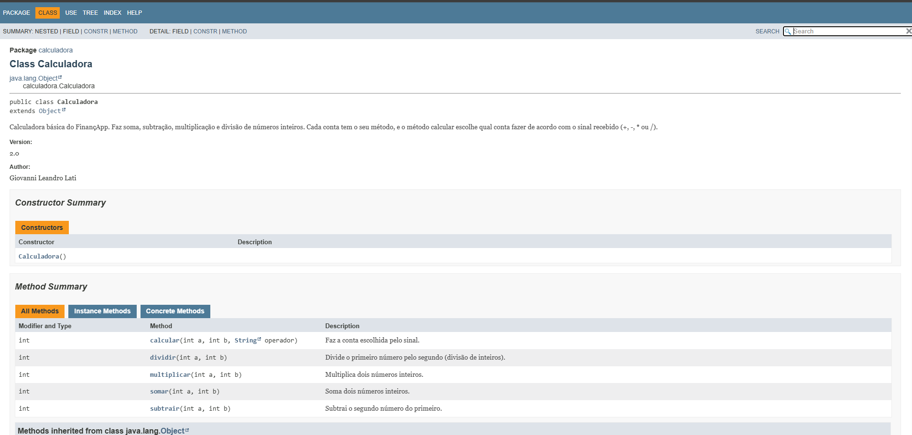
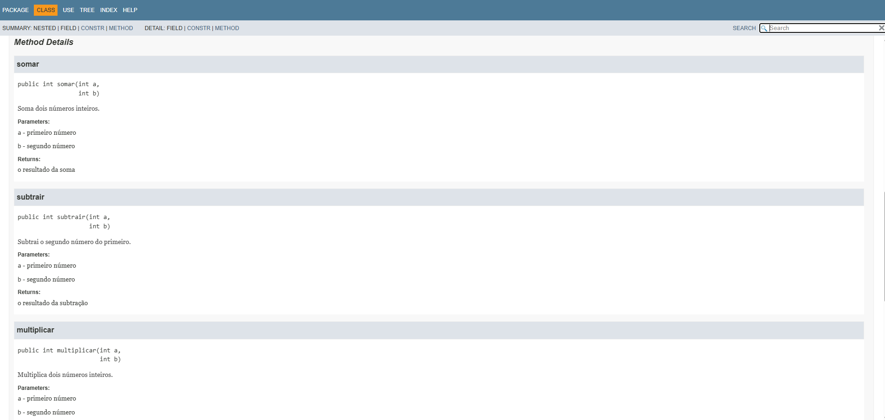

# Projeto Calculadora — FinançApp

> Projeto acadêmico desenvolvido com foco em Qualidade de Software, Testes, Refatoração, Documentação e Versionamento.

---

## 1. Identificação do Projeto

**Projeto:** Projeto Calculadora  
**Contexto:** FinançApp  
**Aluno:** Giovanni Leandro Lati  
**RA:** 250870  
**Curso:** Análise e Desenvolvimento de Sistemas (ADS)  
**Disciplina:** UX/UI e Testes de Software  
**Professor:** Daniel Ohata  
**Semestre:** 2026.2  

---

# 2. Visão Geral

O projeto é um módulo de cálculos básicos em Java, feito para a startup fictícia **FinançApp**.

Ele foi pensado para ser usado no futuro em funções de controle financeiro, como:

- orçamento mensal;
- divisão de despesas;
- projeções financeiras;
- cálculos auxiliares.

Além de fazer as contas certas, o projeto usa práticas de qualidade de software:

- testes;
- tratamento de erros;
- refatoração;
- documentação;
- versionamento;
- manutenção de código.

---

# 3. Problema

Durante o desenvolvimento do FinançApp, a equipe percebeu que precisava de um módulo de cálculos que pudesse ser reaproveitado em várias partes do aplicativo.

A equipe também definiu que ele não poderia só funcionar. Ele precisava ter:

- código fácil de ler;
- testes;
- tratamento de falhas;
- documentação técnica;
- controle de versões;
- facilidade de manutenção.

O desafio foi criar uma calculadora que funciona e, ao mesmo tempo, segue boas práticas de Engenharia de Software.

---

# 4. Objetivo

## 4.1 Objetivo Geral

Criar uma calculadora em Java aplicando testes, tratamento de erros, refatoração, documentação e versionamento.

## 4.2 Objetivos Técnicos

- fazer as quatro operações básicas;
- tratar entradas inválidas;
- impedir divisão por zero;
- criar testes que mostram entrada, resultado esperado e resultado obtido;
- refatorar o código sem mudar o resultado das contas;
- documentar classes e métodos com JavaDoc;
- gerar a documentação em HTML;
- usar Git e GitHub;
- organizar commits e branches;
- manter a documentação no README.

---

# 5. Escopo Funcional

| ID | Funcionalidade | Descrição | Status |
|---|---|---|---|
| RF01 | Soma | Soma dois números inteiros | ✅ |
| RF02 | Subtração | Subtrai dois números inteiros | ✅ |
| RF03 | Multiplicação | Multiplica dois números inteiros | ✅ |
| RF04 | Divisão | Divide dois números inteiros | ✅ |
| RF05 | Validação de divisão | Impede divisão por zero | ✅ |
| RF06 | Operação inválida | Trata sinais que não existem | ✅ |

---

# 6. Requisitos Não Funcionais

| ID | Categoria | Requisito |
|---|---|---|
| RNF01 | Qualidade | O código deve ser organizado e fácil de ler |
| RNF02 | Testabilidade | As operações devem ter testes |
| RNF03 | Manutenção | O código deve poder ser refatorado sem mudar o resultado |
| RNF04 | Documentação | Classes e métodos devem ter JavaDoc |
| RNF05 | Versionamento | O projeto deve usar Git e GitHub |
| RNF06 | Confiabilidade | Erros não devem derrubar o programa sem aviso |

---

# 7. Tecnologias Utilizadas

| Tecnologia | Versão | Utilização |
|---|---|---|
| Java | 21 | Desenvolvimento |
| JDK | 21 | Compilação |
| Git | XX | Controle de versão |
| GitHub | — | Repositório remoto |
| JavaDoc | — | Documentação |
| Eclipse IDE | 2025-03 | Ambiente de desenvolvimento |

Os testes foram feitos na classe `TesteCalculadora`, que roda pelo método `main`, como foi mostrado em aula. Por isso o JUnit não foi usado.

---

# 8. Estrutura do Projeto

```text
projeto_calculadora/
│
├── src/
│   └── calculadora/
│       ├── Calculadora.java
│       └── TesteCalculadora.java
│
├── docs/
│   └── index.html
│
├── images/
│   ├── testes/
│   └── javadoc/
│
├── README.md
└── .gitignore
```

---

# 9. Explicação das Operações

A calculadora recebe dois números inteiros e o sinal da conta.

| Operação | Sinal | Método | Exemplo | Resultado |
|---|---|---|---|---|
| Soma | `+` | `somar` | 2 + 3 | 5 |
| Subtração | `-` | `subtrair` | 10 - 4 | 6 |
| Multiplicação | `*` | `multiplicar` | 3 * 5 | 15 |
| Divisão | `/` | `dividir` | 8 / 2 | 4 |

**Divisão por zero:** não existe conta dividida por zero. Por isso o método `dividir` confere se o segundo número é zero e, se for, avisa o erro em vez de calcular.

**Sinal inválido:** se o sinal não for `+`, `-`, `*` ou `/` (por exemplo `x`), o programa também avisa o erro.

---

# 10. Testes

Os testes estão na classe `TesteCalculadora`. Cada teste mostra as entradas, o resultado esperado, o resultado obtido e se passou.

| Teste | Entradas | Esperado | Obtido | Resultado |
|---|---|---|---|---|
| Soma | 2 + 3 | 5 | 5 | PASSOU |
| Subtração | 10 - 4 | 6 | 6 | PASSOU |
| Multiplicação | 3 * 5 | 15 | 15 | PASSOU |
| Divisão | 8 / 2 | 4 | 4 | PASSOU |
| Divisão por zero | 8 / 0 | erro | erro | PASSOU |
| Operação inválida | 5 x 5 | erro | erro | PASSOU |

## 10.1 Teste da versão inicial (branch main)

Na versão inicial, os dois erros mostram uma mensagem e devolvem 0.



## 10.2 Teste depois da refatoração (branch Refatoracao)

Depois da refatoração, os dois erros viram uma exceção (`IllegalArgumentException`), e o teste pega essa exceção com `try/catch`.



---

# 11. Refatoração

A refatoração foi feita na branch `Refatoracao`. O resultado das contas continua o mesmo, só o código ficou mais organizado.

| O que mudou | Antes | Depois |
|---|---|---|
| Métodos | Tudo dentro de um método só | Um método para cada conta |
| Condições | Vários `if / else if` | Um `switch` |
| Nomes | `calc`, `r`, `op` | `calcular`, `operador` |
| Variável `r` | Guardava o resultado na classe | Removida, o resultado é devolvido direto |
| Erros | Mensagem na tela e retorno 0 | Exceção com mensagem clara |

Sobre o nome do método: o enunciado usa `calc`, mas na refatoração usei `calcular`, seguindo o exemplo mostrado em aula, porque o nome fica mais claro.

Sobre a variável `r`: ela foi removida de propósito. Assim a classe não guarda o resultado da última conta e cada chamada depende só dos números que recebeu.

Sobre os erros: na versão inicial, uma divisão por zero mostrava a mensagem e devolvia 0, que parece um resultado normal. Agora o erro é avisado de forma clara, e quem chama o método decide o que fazer. Isso não derruba o programa, porque o teste trata a exceção.

---

# 12. Documentação JavaDoc

As classes e os métodos têm comentários JavaDoc com `@author`, `@version`, `@param`, `@return` e `@throws`. A documentação em HTML foi gerada na pasta `docs`.

Para ver, abra o arquivo `docs/index.html` no navegador.







---

# 13. Repositório

Link do repositório: https://github.com/DarkGion/projeto_calculadora

Branches:

- `main`: branch principal, com a versão inicial do projeto;
- `Refatoracao`: versão refatorada, com JavaDoc e testes atualizados.
